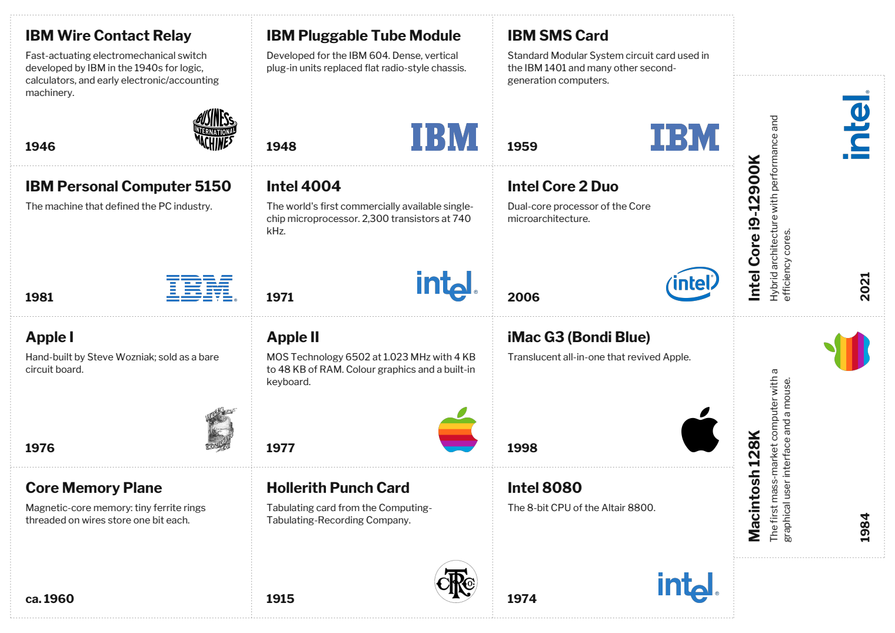
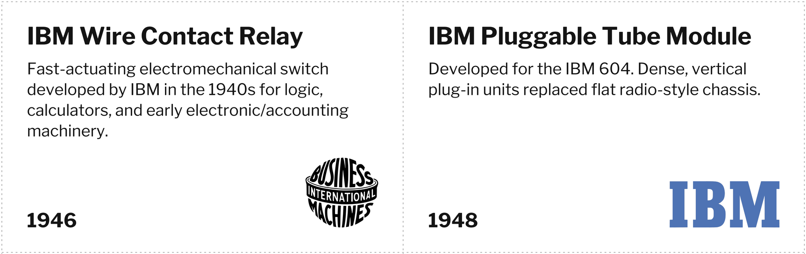

# Museum Signs

**Print exhibit labels for a computer museum: 80 × 50 mm signs with the logo the manufacturer used at the time, 14 to a sheet of A4.**

Museum Signs is a small desktop editor for the labels next to museum objects. You type a title, a short description and a year, then pick the manufacturer. The program chooses the logo that the company used in that year: an IBM relay from 1946 gets the 1924 globe, an IBM PC from 1981 gets the 8-bar logo, an Apple II from 1977 gets the rainbow apple. It then lays the signs out on A4 sheets, ready to print and cut.

It was written for a display of IBM, Intel and Apple artifacts, but you can add any company by dropping a logo file into a folder.



<p align="center"></p>

---

## Features

- **Fixed sign size:** 80 × 50 mm, landscape, with the same layout on every sign:
  - bold **title** top left (up to two lines)
  - description below it
  - **year** bottom left
  - **company logo** bottom right
- **Logos chosen by year.** The program picks the logo from the year you enter. You can still pick a different logo for any single sign.
- **14 signs per A4 sheet.** 12 signs sit upright in a 3 × 4 grid and 2 more are turned sideways in the right-hand strip, so the whole sheet is used. Layouts with 12 and 10 signs per sheet are available for printers that need wider margins.
- **Text that fits.** Long descriptions wrap around the logo and never touch the year. The text shrinks only when it has to, and a warning tells you when it does.
- **Live preview.** The preview in the editor uses the same layout code as the PDF, so the screen shows what will be printed.
- **Typeface:** [Libre Franklin](https://github.com/impallari/Libre-Franklin), a revival of Franklin Gothic, a typeface often used on museum labels.
- **Saving.** Everything is saved automatically to `signs.csv`, which also opens in Numbers, Excel or LibreOffice.
- **Dotted cut lines.** Signs that touch share one dotted line, so you can cut a whole sheet with straight guillotine cuts.
- **Unicode text.** German umlauts, typographic quotes and dashes print correctly.

## Built-in logo timeline

| Company | Logo | Used for years |
|---|---|---|
| IBM | Computing-Tabulating-Recording Co. (CTR) | – 1923 |
| IBM | "International Business Machines" globe | 1924 – 1946 |
| IBM | Beton Bold wordmark | 1947 – 1955 |
| IBM | Paul Rand solid wordmark | 1956 – 1971 |
| IBM | Paul Rand 8-bar striped | 1972 – today |
| Intel | Dropped-e | 1968 – 2005 |
| Intel | Swirl | 2006 – 2019 |
| Intel | Current wordmark | 2020 – today |
| Apple | Newton woodcut | 1976 |
| Apple | Rainbow apple | 1977 – 1997 |
| Apple | Monochrome apple | 1998 – today |

"None" is also available: the sign then has no logo.

## Installation

You need Python 3.10 or newer with Tk. On macOS, the Python from [python.org](https://www.python.org/downloads/) or Homebrew `python-tk` both work.

```bash
git clone https://github.com/<your-account>/museum-signs.git
cd museum-signs
python3 -m venv .venv
.venv/bin/pip install -r requirements.txt
```

**macOS:** you can skip the manual steps. Double-click **`Museum Signs.app`**. The first time it starts, it creates the virtual environment and installs the dependencies itself (this needs internet once). If macOS blocks the app, right-click it and choose **Open** once. `Museum Signs.command` is a Terminal-based alternative.

**Windows / Linux:** run `python museum_signs.py` (use `.venv\Scripts\python` on Windows).

## Usage

1. Start the editor (`Museum Signs.app`, or `.venv/bin/python museum_signs.py`).
2. **+ New sign** (⌘N) adds a sign. It takes over the company of the selected sign.
3. Enter **Title**, **Description** and **Year**, and choose the **Company**. The year can be free text such as `ca. 1960` or `1950–1955`; the first four-digit number decides the logo.
4. Optional: choose a different logo in the **Logo** menu.
5. Watch the preview. A red note appears if the text had to be shrunk or cut off.
6. **Create PDF – ALL signs** (⌘P), or select some signs (⌘/⇧-click) and use **Create PDF – selected only** to reprint just those.
7. Print the PDF at **100 % / Actual size**, not "Fit to page", and cut along the dotted lines.

Other buttons: **Duplicate** (⌘D), **Delete**, **▲ ▼** to change the order on the sheet.

The first time you start the editor, it shows the example signs from `signs.example.csv`. Your own signs are saved to `signs.csv`, which is git-ignored by default (see [Your data](#your-data)).

### Sheet layouts

| Layout | Signs per A4 | Page margin | Notes |
|---|---|---|---|
| 14 per sheet | 14 | 3.5 mm left/right, 5 mm top/bottom | Default. Uses the most of the sheet. |
| 12 per sheet | 12 | 5 mm | Landscape 3 × 4 grid |
| 10 per sheet | 10 | about 25 mm | Portrait, for printers that can't print near the edge |

On printers with a larger non-printable border, only the outermost dotted line may be lost; the sign content has its own 5 mm padding.

### Command line

You can build the PDF without opening the window:

```bash
.venv/bin/python museum_signs.py --pdf                       # signs.csv -> "Museum Signs.pdf"
.venv/bin/python museum_signs.py --pdf --layout 10 --no-open
.venv/bin/python museum_signs.py --pdf --csv other.csv -o other.pdf --no-cut-lines
```

### CSV format

```csv
title,description,year,company,logo
IBM Wire Contact Relay,"Fast-actuating electromechanical switch ...",1946,IBM,auto
```

`company` must match a company in `logos/logos.csv`, or be `None`. `logo` is `auto` or the file name of a specific logo. Line breaks inside a quoted description are kept on the sign.

## Adding a company or logo

Logos are listed in [`logos/logos.csv`](logos/logos.csv):

```csv
company,from_year,file,scale,note
IBM,1947,IBM_1947_beton.png,1.0,Beton Bold wordmark (1947-1955)
```

- A logo is used from `from_year` until the next entry for the same company.
- Put a PNG with a transparent background and no empty border into `logos/`, then add a line. The company appears in the Company menu automatically.
- `scale` makes a single logo bigger or smaller (e.g. `1.15`). Logos are sized automatically so that wide and tall logos look about equally heavy.

## Customising the design

All design values are at the top of [`museum_signs.py`](museum_signs.py):

- sign size and padding (`SIGN_W`, `SIGN_H`, `PAD`)
- font sizes (`TITLE_MAX`, `DESC_MAX`, `YEAR_SIZE`, …)
- spacing and logo size limits
- colours

To use a different font, replace the TTF files in `fonts/` and update `FONT_FILES`.

## Project structure

```
museum_signs.py            editor (Tkinter) + layout engine + PDF export (ReportLab)
Museum Signs.app           macOS launcher (compiled from launcher/Museum Signs.applescript)
Museum Signs.command       Terminal launcher (fallback)
signs.example.csv          example data, used when signs.csv does not exist yet
logos/                     logo PNGs, logos.csv (timeline), source/ (original SVG/PNG), SOURCES.md
fonts/                     Libre Franklin + OFL license
docs/                      example sheet (PDF/PNG) for this README
requirements.txt           reportlab, pillow
```

To rebuild the macOS launcher after editing it:

```bash
osacompile -o "Museum Signs.app" "launcher/Museum Signs.applescript"
```

## Your data

`signs.csv` (your labels) and the generated `Museum Signs.pdf` are listed in `.gitignore`, so a public repository contains only the code and the example. To keep your museum's labels under version control as well, remove those two lines from `.gitignore`.

## License

- **Code:** [MIT License](LICENSE) © 2026 Manfred Amann
- **Font:** Libre Franklin, © The Libre Franklin Project Authors, [SIL Open Font License 1.1](fonts/OFL.txt)
- **Logos:** public-domain files from Wikimedia Commons; see [`logos/SOURCES.md`](logos/SOURCES.md) for each source. The IBM, Intel and Apple logos are **trademarks of their respective owners**. They are included only to identify the manufacturer of historical objects on museum labels. This project is not affiliated with or endorsed by IBM, Intel or Apple.
